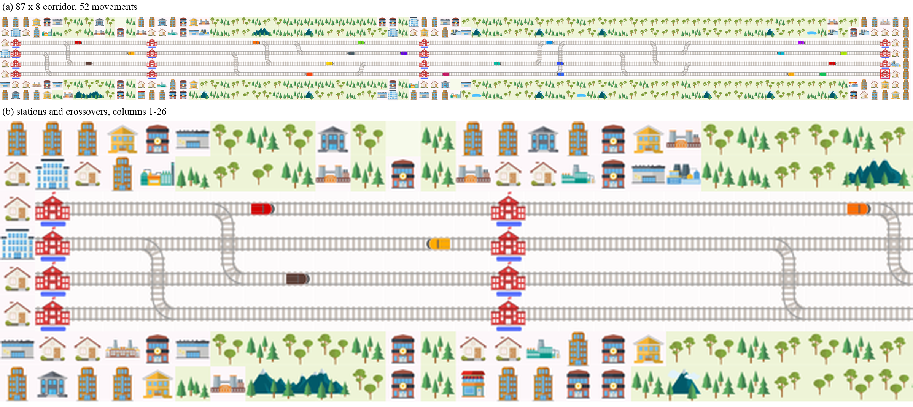
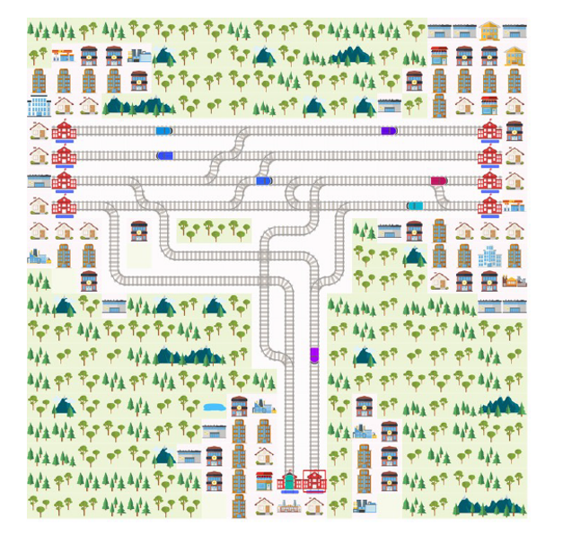
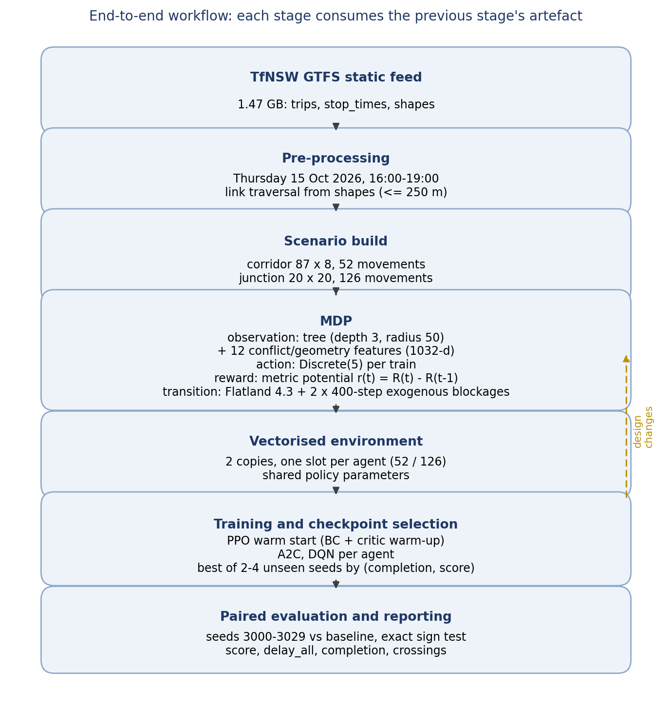
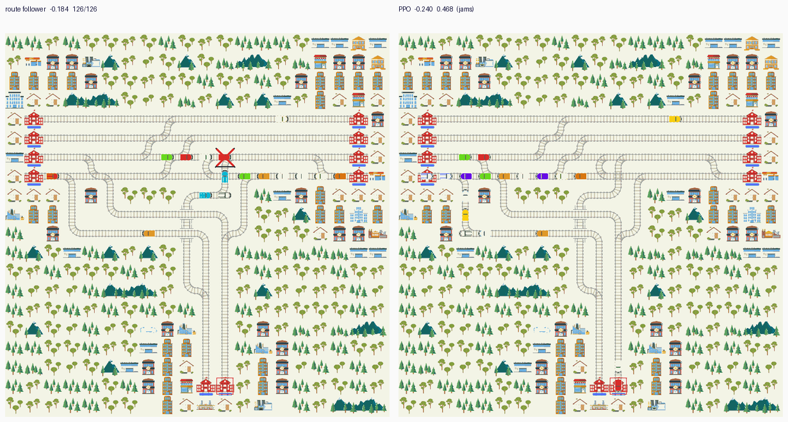
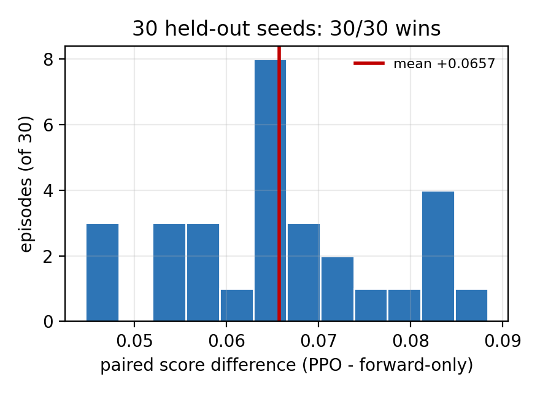
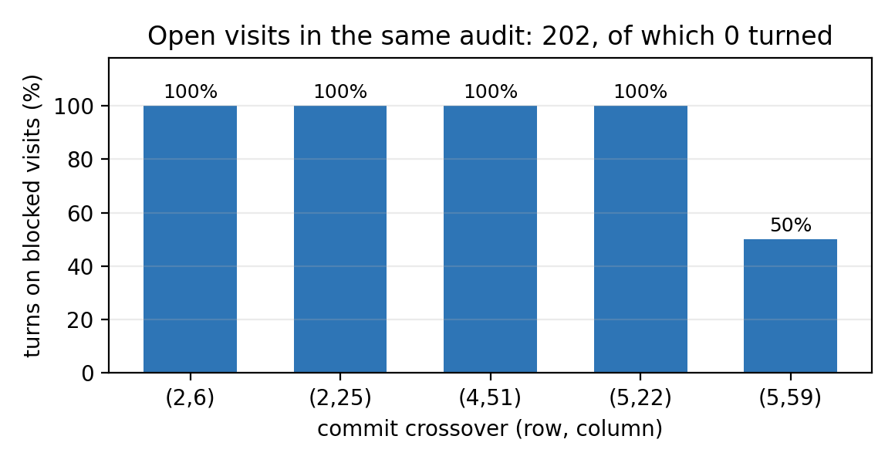

::: {custom-style="Title"}
43008: Reinforcement Learning
:::

::: {custom-style="Subtitle"}
Assignment 3, Part E Project Report
:::

**Project Title: Train Schedule Optimisation under Disruptions**

*Learning to change track when a corridor is blocked*

**Team Name and Project Number:** RailTech (Project #27)

**Team Members:** Daniel James Martirosov (24948933), Ziheng Deng (25595315), Laurean Lim (25049863)

**Date:** 26 October 2026

```{=openxml}
<w:p><w:r><w:br w:type="page"/></w:r></w:p>
```

## Table of Contents

@@TOC@@

```{=openxml}
<w:p><w:r><w:br w:type="page"/></w:r></w:p>
```

# Abstract

We ask whether a learned policy can beat a schedule-following controller when a track becomes unavailable. Two Flatland scenarios come from the October 2026 TfNSW GTFS feed: a four-track Central-Strathfield corridor with 52 movements and the Granville-Harris Park junction with 126. The corridor uses an exogenous blockage that removes a cell's rail transitions for 400 steps, so a policy cannot cancel the incident by rerouting. Only the warm-started PPO learns to change track: it lifts the metric from -0.0662 to -0.0005, a paired gain of +0.0657 on 30 held-out seeds (30 of 30, p < 1e-4), and takes no crossing on a clean network. No crossing appears in A2C's rendered episode, and DQN parks half the fleet. The junction is still a loss against the scripted baseline (-0.2400 against -0.1823, two seeds).

```{=openxml}
<w:p><w:r><w:br w:type="page"/></w:r></w:p>
```

# 1. Introduction and Background

### 1.1 The problem you tried to solve

Railway scheduling involves coordinating multiple trains across shared infrastructure, including tracks, junctions and crossovers, while maintaining safe and reliable operations (Li et al., 2021). As railway infrastructure has limited capacity, delays affecting individual services can lead to conflicts in train schedules and propagate across interconnected railway networks, creating significant challenges for railway planners and train controllers (Li et al., 2021). These disruptions can result from various unpredictable factors, including equipment failures, signalling faults, fluctuations in passenger demand and adverse weather conditions (Li et al., 2021). The impact of these challenges remain evident in Sydney's railway network, where suburban train punctuality averaged 87.5% in 2024–25, falling below the established 92% target (Sydney Trains, 2025). Recent incidents also highlight the network’s susceptibility to operational disruptions. In June 2024, a signalling at Harris Park resulted in delays that exceeded one hour (Roberts, 2024), while an overhead wiring failure near Strathfield in May 2025 disrupted train services for more than 24 hours (Gorrey et al., 2025).

Managing train movements under these conditions presents a complex real-time scheduling problem, particularly when multiple services must share limited track capacity. Train controllers must consider infrastructure availability, potential conflicts between train movements and the potential for decisions to generate further delays (Zhu & Goverde, 2019). In response to these challenges, this project explores the application of reinforcement learning to railway scheduling and rerouting. Using simulated railway environments, the study examines how different reinforcement learning strategies coordinate train movements and respond to both normal operating conditions and unexpected disruptions.

### 1.2 Motivation

Improving railway scheduling is essential for maintaining reliable passenger services and ensuring the efficient utilisation of existing railway infrastructure (Šemrov et al., 2016; Zhu & Goverde, 2019). Delays and disruptions can negatively affect passenger journeys, increase travel-time uncertainty and reduce overall efficiency of railway networks, particularly in interconnected metropolitan railway systems (Li et al., 2021). Given the capacity constraints of railway infrastructure, the development of reliable timetables alone may not be sufficient to address unexpected disruptions (Li et al., 2021). Effective scheduling and rerouting strategies are therefore necessary to strengthen operational resilience, minimise delay propagation and maintain service continuity (Zhu & Goverde, 2019). Exploring alternative methods of coordinating train movements may provide insights into improving railway operations without necessarily requiring additional infrastructure investment (Šemrov et al., 2016).

Reinforcement learning (RL) presents a promising approach to this problem because railway scheduling involves sequential decision-making in dynamic and often unpredictable operating conditions (Šemrov et al., 2016). Unlike approaches that rely exclusively on predefined decision rules, RL agents can learn strategies through interactions with an environment and feedback from their actions (Sutton & Barto, 2018). This learning process makes RL a potential solution for railway scheduling, where train movements must be continually adjusted in response to changing network conditions and emerging conflicts.

Furthermore, simulation provides a controlled and repeatable environment in which scheduling strategies can be investigated without interfering with live railway operations. By modelling different railway layouts and disruption scenarios, scheduling strategies can be evaluated under consistent conditions, allowing their relative strengths and limitations to be examined before considering potential real-world applications. Therefore, to explore this potential, the project uses the Flatland railway simulation environment to model train scheduling and rerouting across selected Sydney railway corridors (Mohanty et al., 2020). Three RL algorithms—Proximal Policy Optimisation (PPO), Advantage Actor-Critic (A2C) and Deep Q-Network (DQN)— are evaluated under both normal and disrupted operating conditions to compare their relative performance in coordinating train movements.

### 1.3 Application

The primary application of this project is an RL-based train scheduling and rerouting system developed within the Flatland simulation environment. Using simplified representations of selected Sydney railway corridors, the system enables different reinforcement learning algorithms to be evaluated under normal and disrupted operating conditions. Through simulated train movements and comparative performance results, the system aims to identify the relative strengths and limitations of different scheduling strategies in managing delays, congestion and successful train arrivals. The results may offer valuable insights for researchers, developers and railway planners exploring adaptive railway traffic management and decision-support systems. However, the system is evaluated entirely through simulation and is not intended for direct deployment on operational railway networks.

### 1.4 Dataset/Environment

Flatland is a multi-agent railway simulation environment designed to investigate train coordination and decision-making problems (Mohanty et al., 2020). In this environment, individual trains are represented as agents navigating a grid-based railway network consisting of interconnected tracks, switches and designated destinations (Mohanty et al., 2020). Agents must coordinate their movements while accounting for shared infrastructure and potential conflicts with other trains (Mohanty et al., 2020). The environment also supports simulated malfunctions and disruptions, enabling the evaluation of scheduling and rerouting strategies under varying operating conditions (Mohanty et al., 2020).

For this project, two railway scenarios were developed to represent selected sections of Sydney's metropolitan railway network: the Central–Strathfield corridor (Scenario 1) and the Granville–Harris Park corridor (Scenario 2). Each scenario incorporates railway track layouts and timetable information to model train routes and movements within the simulation environment. Both normal operating conditions and delayed scenarios are considered to investigate how different scheduling approaches respond to disruptions. Figures 1 and 2 illustrate the simulated railway environments used in the project.

{width=85%}

{width=95%}

```{=openxml}
<w:p><w:r><w:br w:type="page"/></w:r></w:p>
```

# 2. Overview of the architecture/system

## 2.1 Flow Diagram and Workflow

The workflow runs in seven stages, each with a defined input and output (Figure 3). The dashed arrow is deliberate: every change to the observation, reward or disruption regime was re-validated by re-running the same paired evaluation, so this report only contains numbers produced by the final configuration, with the three labelled junction rows of Table 5 as the one disclosed exception.

{width=90%}

- Service extraction: the GTFS feed (about 1.4 GB) is filtered to one Thursday peak, with link traversal times derived from the shapes.
- Scenario construction: two Flatland levels and two timetables, the corridor (87 x 8, 52 movements) and the junction (20 x 20, 126 movements).
- MDP construction: level, timetable and disruption regime, with a tree observation, a per-train discrete action and the metric potential as reward.
- Vectorisation and training: two copies of the fleet for PPO, one for A2C and DQN, one sub-environment per train, shared policy parameters.
- Checkpoint selection: PPO is scored every 100k steps on unseen seeds 9001 to 9004 (thirteen evaluations); A2C and DQN every 400k steps on two seeds, completion first.
- Paired evaluation and reporting: the corridor arm and its baseline on the same 30 held-out seeds (3000 to 3029), with an exact sign test.
- Decision audit: every visit to a commit crossover is recorded with whether a blocked cell lay ahead, so the crossings can be shown to be conditional.

## 2.2 System Architecture Design

One shared multi-layer perceptron controls every train: 1032 inputs, two hidden layers (256 units for PPO, 128 for A2C and DQN) and a five-way action head. The observation is a flattened, normalised tree of depth 3 within a radius of 50 cells, plus twelve conflict and geometry features: slack and its rank, distance to the first occupied cell, distance to oncoming traffic, malfunctioning trains on my route, my own malfunction countdown, current speed, whether I am on the map, remaining route length, queue depth, distance to the nearest blocked cell ahead, and distance to my next commit crossover. The last two exist because a zeroed rail cell is invisible to occupancy features, so without them the crossing decision is not expressible.

The reward is the assessment metric paid densely as a potential, r(t) = R(t) - R(t-1), where R(t) is what the metric would charge if the episode ended at t. The sum telescopes to the metric exactly, verified per agent and per term to machine precision, and training divides the potential by a constant 100 so the value targets stay O(1). All reported arms also use two shaping bonuses on top of the potential: +50 for every train that arrives and -1 for every step a train is stuck, at the same 1/100 scale, which is disclosed here because the reported arm is not the bare-metric arm.

From a random initialisation neither control algorithm finds the crossing in its rendered episode, so the reported corridor arm is PPO fine-tuned from a behaviour-cloned detour baseline (imitation then RL), with the critic warmed up first. The two independent algorithms are the control: they share the observation, reward and regime but not the warm start. The notebook is the assembly point and imports the shared modules from scripts/ instead of duplicating them, so the notebook, the trainers and the evaluator cannot drift apart.

## 2.3 GUI/Environment Design

Flatland's own renderer is the interface, which the brief permits in place of a separate GUI: it shows the rail grid with its switches and crossovers, one coloured marker per train, and a red X on every cell that may not be entered - an exogenous blockage on the corridor, a train standing in malfunction on the junction. Using the simulator's renderer keeps every episode figure inside the same simulator the agents are trained in - drawn through make_env, while training and evaluation use make_parallel_env, which adds the dwell wrapper - and produced headlessly with the PIL backend, so the panel scores are indicative rather than the reported numbers. Figures 1 and 2 are the two levels; Figures 4 and 5 show the same levels under their disruption regimes.

{width=95%}

{width=85%}

The disruption regime is the methodological core. A train-borne failure fires when a train reaches a cell, which makes the disruption a function of the policy's own trajectory: a policy that reroutes early can prevent the incident from firing at all. The corridor therefore uses an exogenous blockage: a cell's rail transitions are removed outright at a seed-drawn step and restored after 400 steps, so the failure exists whether or not a train goes near it. Two are drawn per episode, one per direction, from the cells just past each commit crossover; activation is deferred while a cell is occupied and dropped after 60 steps. Both arms get the same cells at the same seed-drawn steps, so the pairing is by seed and plan.

```{=openxml}
<w:p><w:r><w:br w:type="page"/></w:r></w:p>
```

# 3. Results and Evaluation

## 3.1 Experimental Settings

Table 1 lists the settings. All arms act deterministically; the corridor arm is evaluated on seeds 3000 to 3029, which training and checkpoint selection never see, and A2C and DQN are reported from their selection seeds only. Because the baseline and the arm run on the same seed, the same environment and the same blockages, a delta is computed per seed and the report gives its mean, median, win count and an exact two-sided sign test. The score is the assessment metric normalised to [-1, 0], with each train's cost capped at one episode, summed over all agents and divided by the number of agents and the episode budget; a second statistic, delay_all, charges every agent and uses the episode end for a train that never arrives.

| Item | Corridor | Junction |
|:--|:--|:--|
| Scenario | network-simple-compact | granville-harris-park |
| Level | 87 x 8, four through tracks | 20 x 20 Y-link junction |
| Movements | 52 | 126 |
| Episode budget | 999 steps | 757 steps |
| Disruption | 2 exogenous blockages, 400 steps | 3 train-borne failures, 220 steps |
| Observation | tree depth 3, radius 50, plus 12 features (1032) | same |
| Action | Discrete(5) per train | same |
| Held-out seeds | 3000 to 3029 | 3000 to 3029 (legacy); 3001, 3002 (current) |
| Baseline | forward-only reflex | scripted route follower |

:Table 1: Experimental settings. The maps share the observation, action space and evaluation protocol; they differ in disruption mechanism because only the corridor has a switchable pair of parallel tracks.

The regime and the policy are CPU-bound: Flatland steps the fleet in Python and the 1032-d tree observation is rebuilt for every agent at every step. The shipped corridor run took 1,865 s for 1,224,704 timesteps including thirteen four-episode evaluations (about 660 environment steps per second), and once startup is paid each evaluation interval costs about 148 s, so the evaluator rather than the optimiser sets the wall clock. Training ran on an x86_64 workstation with an RTX 3080 (the system_info inside runs/xb_b/best_model.zip records x86_64 with CUDA available); the notebook and the figures also run on an aarch64 relay with the same pinned stack, and the sixteen tests pass (results/test_run.txt). Every table below is regenerated from the CSVs in results/.

## 3.2 Pre-Processing

- Service extraction: one Thursday service period, with rail links rather than straight lines giving traversal times.
- Corridor level: four adjacent through tracks with the ladder rows removed; the compact map leaves a two-cell diversion premium at 7 of the 15 stop types.
- Junction level: a 20 x 20 level from the published track plan, with the turn sequence read out of the timetable as a route dictionary.
- Deadlines and episode budget: calibrated from a reference rollout, with the budget extended past the last arrival because the serialised value cut 15 junction trains off mid-journey.
- Multi-cell targets: the target set is rebuilt from the agent's own last waypoint group after every reset, otherwise a diverted train can never finish.
- Dense reward: the metric as a potential, verified against DefaultRewards per agent and per term.
- Metric hygiene: delay_all replaced a total-delay statistic that went NaN when nothing finished and negative when few did.
- Regime hygiene: the blockage is exogenous, so the disrupted condition cannot collapse into the undisrupted one.

## 3.3 Experimental Results

The corridor result is the headline. PPO improves the score from -0.0662 to -0.0005, a mean paired gain of +0.0657 with a median of +0.0648 (Table 2). It wins all 30 seeds and every train completes in both arms, so the gain is punctuality rather than cancellation: total lateness falls from 3321 steps to -70. The on-time share moves only from 0.625 to 0.635, so the gain is in how late the affected trains are, not in which trains complete. Figure 6 shows the per-seed spread.

| Arm | Baseline | Arm | Delta | Wins | Sign test p | Completion | delay_all |
|:--|--:|--:|--:|--:|--:|--:|--:|
| PPO | -0.0662 | -0.0005 | +0.0657 | 30/30 | < 1e-4 | 1.000 → 1.000 | 3321 → -70 |

:Table 2: Corridor, 30 paired held-out seeds under the block regime. Only PPO has the full paired test; Table 3 reports what the other two algorithms did in training.

{width=62%}

The two independent algorithms are the control for the claim that learning the crossing is not automatic; Figure 7 traces all three arms over the training budget.

| Arm | Best checkpoint | Internal score | Completion | Behaviour in Figure 4 |
|:--|--:|--:|--:|:--|
| PPO (warm start) | 745k | -0.0005 | 1.000 | crosses only when blocked |
| A2C | 400k | -0.0563 | 1.000 | no crossing in the panel |
| DQN (gamma 0.999) | 400k | -0.3234 | 0.529 | parks half the fleet |

:Table 3: Corridor training outcome per arm. Score and completion are the selection-seed numbers, not the 30-seed paired numbers in Table 2; the behaviour column is a reading of the Figure 4 panels, which are rendered with make_env rather than the evaluator.

{width=85%}

A score gain alone does not prove the policy changes track for the right reason, since a policy that crossed at every crossover would also gain on this map. The audit counts the decisions themselves: for every agent-step standing on a commit crossover it records whether a blocked cell lay ahead on that train's own row within 60 cells, and whether the agent chose a lateral action. The per-crossover table is shipped as results/crossing_audit_block.csv.

| Crossover | Track | Blocked visits | Turns | Open visits | Turns |
|:--|--:|--:|--:|--:|--:|
| (2,6) | up_suburban | 22 | 22 | 30 | 0 |
| (2,25) | up_suburban | 2 | 2 | 28 | 0 |
| (2,62) | up_suburban | 0 | 0 | 46 | 0 |
| (4,51) | up_local | 18 | 18 | 58 | 0 |
| (5,4) | down_local | 0 | 0 | 14 | 0 |
| (5,22) | down_local | 19 | 19 | 14 | 0 |
| (5,59) | down_local | 40 | 20 | 12 | 0 |
| Total |  | 101 | 81 | 202 | 0 |

:Table 4: Per-crossover decision audit over seeds 3000 and 3001. Blocked means an impassable cell ahead on the train's own row within 60 cells. (5,59) is the only crossover with blocked visits that did not always turn (20 of 40); the CSV records counts rather than per-visit causes, so none is claimed.

{width=70%}

Of 101 agent-steps standing on a crossover with a blocked cell ahead, 81 produced a turn; of 202 with a clear track, 0 did. The audit records one decision per visit to a commit cell, so 81 turns over two seeds is about 40 diverts per episode. The rate is not uniform - four crossovers turn on every blocked visit and (5,59) on 20 of 40 - so the behaviour is state-dependent, not a blanket lane swap, and the A2C and DQN panels of Figure 4 show what the two degenerate alternatives look like - never turning, and parking.

Under the clean condition the same checkpoint is inert: on 3 seeds it scores 0.0000, exactly as the forward-only baseline does, and the decision audit records 546 visits to a commit crossover with a clear track and not one turn (results/clean_audit.csv). With the blockage suppressed but the Poisson malfunction layer left on, the arm is indistinguishable from the baseline: -0.0133 against -0.0165, a paired +0.0032 on 3 seeds, 3 of 3 but p = 0.25. The crossings in Table 4 therefore belong to the blockage, not to the policy's habit.

The junction is reported as a loss, and its two failure modes bracket the metric's pathology.

| Arm | Baseline | Arm | Delta | Wins | Completion (base → arm) |
|:--|--:|--:|--:|--:|:--|
| PPO (30 seeds, 1030-d) | -0.1769 | -0.0251 | +0.1518 | 30/30 | 1.000 → 0.000 |
| A2C (30 seeds, 1030-d) | -0.1769 | -0.0251 | +0.1518 | 30/30 | 1.000 → 0.000 |
| DQN (30 seeds, 1030-d) | -0.1769 | -0.0208 | +0.1561 | 30/30 | 1.000 → 0.183 |
| PPO (current, 2 seeds) | -0.1823 | -0.2400 | -0.0577 | 0/2 | 1.000 → 0.468 |

:Table 5: Junction results. The first three rows are the recorded 30-seed runs from before the two observation features were added, kept as measured: that policy parks the fleet. The last row is the current checkpoint selected by completion, which departs and jams; it is a two-seed evaluation shipped as results/junction_current.csv, identically scored on both seeds, so treat it as one behaviour. The rows are not directly comparable.

Parking scores better than attempting: every learned 30-seed arm scores about +0.15 better than the route follower while completing 0 to 18 per cent of the trains, because a cancellation costs about 19 cost units while a dispatch into the jam is charged its full delay. The current checkpoint shows the other side: selected by completion rather than score, it sends every dispatched train into the throat, completing 59 of 126 and scoring -0.2400, worse than the scripted baseline at -0.1823 with 126 of 126 home (Figure 5). Neither is a working junction policy; a global controller, or imitation of the route follower, is what that map needs.

## 3.4 Limitations

- Only PPO has the full 30-seed paired test on the corridor. A2C and DQN are reported from their selection seeds and the rendered episode; a paired run for them would strengthen the three-algorithm claim and is the obvious next experiment.
- The corridor decision is local: one crossover per blocked stretch and a two-cell detour. The result is not evidence that per-agent RL can arbitrate a junction.
- The disruption volume is a modelling choice, not data: 2 x 400 steps keeps completion at 1.000 while making every affected trip late.
- From-scratch learning does not find the crossing, and the A2C and DQN arms demonstrate it independently. The corridor arm is imitation-then-RL, not pure exploration: the warm-start checkpoint scores -0.0010 before fine-tuning, against the -0.0005 of the hand-written rule it was cloned from (runs/xb_b/eval.csv, results/all_arms.md).
- The 30 held-out seeds vary the blockage placement only: fleet, timetable and deterministic actions are fixed, a single training seed per arm was run, and the mean delta has a sign test but no confidence interval.
- The junction table mixes two observation versions; the 30-seed checkpoints predate the two feature additions and no longer load. They are reported as measured and labelled.
- Evaluation is entirely simulated. The timetable and the track layout are real; there is no operational validation and no human factors layer.

```{=openxml}
<w:p><w:r><w:br w:type="page"/></w:r></w:p>
```

# 4. Discussion and Conclusions

A local policy can learn to reroute, but only if the evaluation makes the decision real and the recipe can find a sparse action. On a four-track corridor cut by 400-step exogenous blockages, PPO changes track at the commit crossover just before the blockage: it moves the score from the forward-only baseline's -0.0662 to -0.0005 over 30 held-out seeds, winning every seed without losing a train. The recipe is load-bearing: a behaviour-cloned detour teacher supplies the warm start, the critic is warmed up before the policy is unfrozen, and from a random initialisation neither control finds the crossing in its rendered episode. The same checkpoint does nothing when nothing is blocked, and the decision audit over seeds 3000 and 3001 shows that its crossings follow the blockage rather than the map.

One bound keeps that honest: the learned arm reproduces its teacher rather than beating it. The hand-written detour rule it is cloned from scores -0.0005 (results/all_arms.md), the same figure as the arm, so what the policy adds is a per-train decision procedure at the same cost, not a better schedule.

The result depended on fixing the measurement first. A train-borne failure fires when a train arrives, so a policy that reroutes suppresses the incident, and a failure placed deep inside a station's escape band leaves every follower already past the crossover. Removing the cell's transitions instead makes the blockage exogenous, gives both arms the same seed-drawn plan, and turns the delayed comparison into a real decision. The controls bound how far that goes: the checkpoint is inert on an unblocked network (0.0000, and no turn in 546 visits), but with the blockage suppressed and the Poisson malfunction layer left on it is indistinguishable from the baseline (-0.0133 against -0.0165, 3 of 3 seeds but p = 0.25). The gain therefore belongs to a long exogenous hold, not to disruption in general.

The junction is where the metric, not the learner, is the story. Parking wins on the metric because a cancellation is charged about 19 cost units while a dispatch into the jam pays its full delay: three 30-seed arms score about +0.15 better than the route follower while completing 0 to 18 per cent of the trains. Selecting the checkpoint by completion reverses the failure without fixing it: the current arm sends every dispatched train into the throat, completes 59 of 126 and scores -0.2400 against a two-seed baseline of -0.1823. That row also comes from a later observation version than the three above it, so it is read on its own rather than as a like-for-like comparison. Read together, the two rows say the same thing: the metric ranks cancelling a service above delaying it, and no local policy arbitrates one throat.

What this establishes is narrow: on a corridor with two switchable pairs of tracks, a warm-started PPO learns to take the commit crossover when the track ahead is blocked, and never takes one when the track is clear. Necessity is what the audit proves (0 turns in 202 open-track visits); sufficiency is only approximate, since 81 of 101 blocked visits turned and (5,59) turned on 20 of 40. It does not show that per-agent RL arbitrates a junction, and three limits bound the evidence: one training seed per arm, held-out seeds that vary blockage placement only, and a sign test on the per-seed deltas with no confidence interval. Three extensions follow: the same 30-seed paired run for A2C and DQN, a global view for the junction (a graph or attention observation, or imitation of the route follower), and a comparison against the stronger scripted distance-map baseline. A deployed version would also have to make the decision observable: a signaller needs to know which crossover the policy intends to use before it uses it.

```{=openxml}
<w:p><w:r><w:br w:type="page"/></w:r></w:p>
```

# 5. References

Gorrey, M., Segaert, A., Ganko, J., & Kaine, E. (2025, May 21). ‘Delay all non-essential travel’: Commuters warned to expect more train chaos. The Sydney Morning Herald. https://www.smh.com.au/national/nsw/major-disruptions-expected-as-power-failure-halts-trains-20250520-p5m0t1.html

Li, B., Guo, T., Li, R., Wang, Y., Ou, Y., & Chen, F. (2021). Delay propagation in large railway networks with data-driven Bayesian modeling. Transportation Research Record, 2675(11), 472-485.

Mohanty, S., Nygren, E., Laurent, F., Schneider, M., Scheller, C., Bhattacharya, N., Watson, J., Egli, A., Eichenberger, C., & Baumberger, C. (2020). Flatland-rl: Multi-agent reinforcement learning on trains. arXiv preprint arXiv:2012.05893.

Roberts, M. ( 2024, June 17). Signal repairs cause train disruption in Sydney during Monday morning commute ABC News. https://www.abc.net.au/news/2024-06-17/nsw-sydney-trains-harris-park-service-repair-delay-commute/103985636

Šemrov, D., Marsetič, R., Žura, M., Todorovski, L., & Srdic, A. (2016). Reinforcement learning approach for train rescheduling on a single-track railway. Transportation Research Part B: Methodological, 86, 250-267.

Sutton, R. S., & Barto, A. G. (2018). Reinforcement Learning, second edition: An Introduction. MIT Press. https://books.google.com.au/books?id=uWV0DwAAQBAJ

Sydney Trains. (2025). Sydney Trains Annual Report https://www.transport.nsw.gov.au/system/files/media/documents/2025/sydney-trains-annual-report-2024%E2%80%9325-volume-1.pdf

Zhu, Y., & Goverde, R. M. (2019). Railway timetable rescheduling with flexible stopping and flexible short-turning during disruptions. Transportation Research Part B: Methodological, 123, 149-181.

```{=openxml}
<w:p><w:r><w:br w:type="page"/></w:r></w:p>
```

# Appendices

## A. Individual Contribution

Each group member should write half-page (max) about his or her contribution in the project development activities.

## B. Individual Contribution Split

All the team members have discussed and agreed on the above individual contribution to the project.

| Team Member Name | Percentage |
|:--|--:|
| Daniel James Martirosov | 33.33% |
| Ziheng Deng | 33.33% |
| Laurean Lim | 33.33% |

Daniel James Martirosov : ____________________

Ziheng Deng : ____________________

Laurean Lim : ____________________
